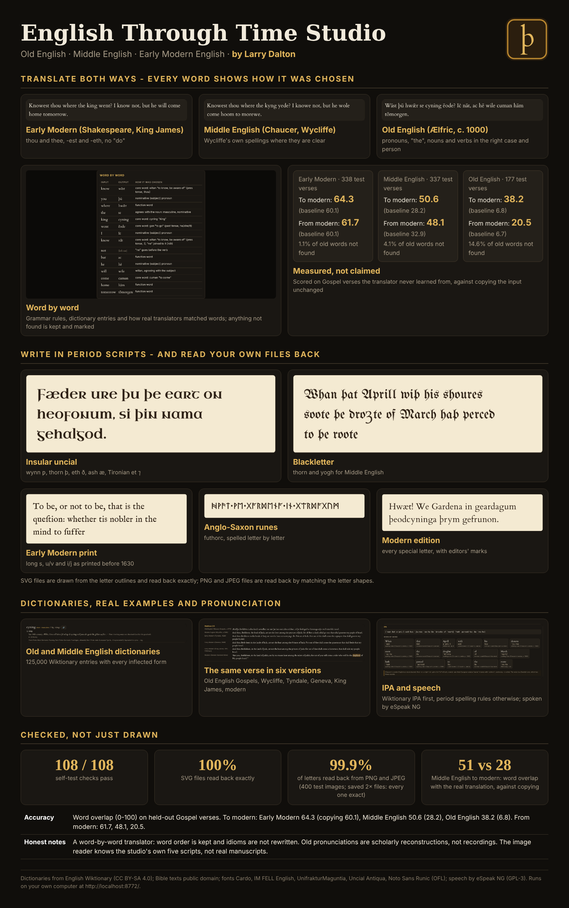
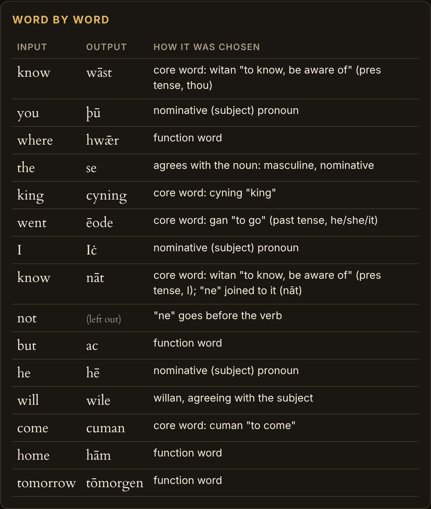
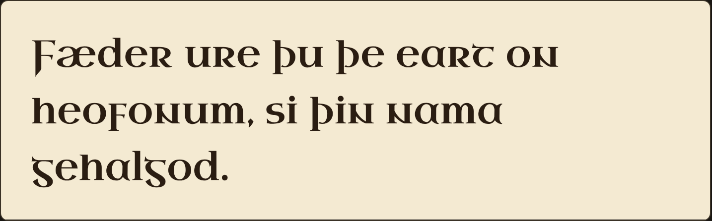
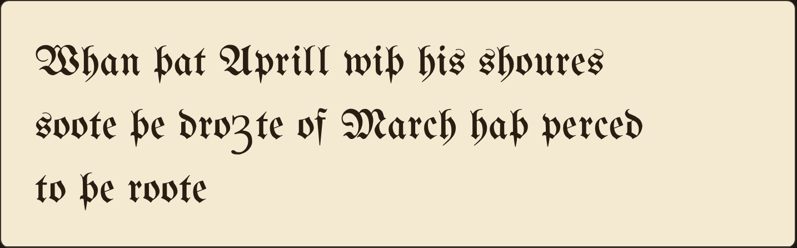
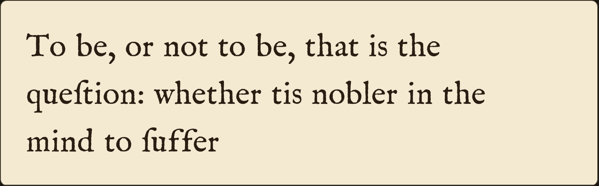
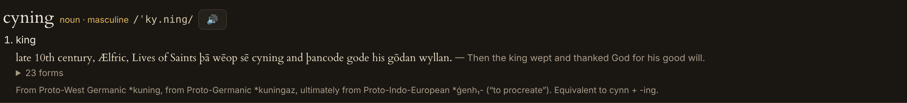

# English Through Time Studio

**by Larry Dalton**

Translate between today's English and three older stages of the language, write them in period scripts, look
words up, read real texts side by side and hear them spoken. Everything runs on your own Windows computer at
`http://localhost:8772/`; nothing you type leaves the machine.

| Period | Dates | Written as |
|---|---|---|
| Old English | c. 450-1150 | classical West Saxon dictionary forms (Ælfric, c. 1000), with editors' marks ā ċ ġ |
| Middle English | c. 1150-1500 | London English of the late 1300s, spelled as in the Wycliffe Bible |
| Early Modern English | c. 1500-1700 | Shakespeare and the King James Bible: thou/thee, -est and -eth, no "do" |

## Translate both ways

- Modern English is tagged word by word (part of speech, subject or object, tense, person); grammar words come from
  tables for each period (pronouns in every case, "the" in every gender and case, verb endings, helping verbs)
- Other words come from the Old and Middle English dictionaries, ranked by how often real translators chose them:
  12,000 Wycliffe verses, 12,000 King James verses and 1,817 Old English Gospel verses were lined up with a modern
  translation (IBM Model 1 word alignment)
- Old English nouns, verbs and adjectives are put in the right case, number and person from the dictionary's own tables of forms
- Going back to modern English, each form is found in the dictionary (heofonum: heofon "heaven", dative plural) and
  given its modern form
- Every word shows how it was chosen; words that could not be found are kept and marked, and the result is rated

### Measured accuracy

Every tenth verse of the four Gospels was kept out of everything the translator learned. The score is the word overlap
(F1, 0-100) between the studio's translation and the real translation of that verse; the baseline is copying the input unchanged.

| | To modern | baseline | From modern | baseline |
|---|---|---|---|---|
| Early Modern (King James, 338 verses) | 64.3 | 60.1 | 61.7 | 60.1 |
| Middle English (Wycliffe, 337 verses) | 50.6 | 28.2 | 48.1 | 32.9 |
| Old English (Wessex Gospels, 177 verses) | 38.2 | 6.8 | 20.5 | 6.7 |

Honest notes: this is a word-by-word translator; word order is kept and idioms are not rewritten. Old English is
measured against a manuscript of about 1175 whose late spellings differ from the classical forms the studio writes.

## Write in period scripts, and read your files back

| | |
|---|---|
|  |  |
|  |  |

Modern edition, Early Modern print (long s, u/v, i/j), blackletter (thorn, yogh), insular uncial (wynn, Tironian et)
and Anglo-Saxon runes (futhorc). Text is shaped with HarfBuzz and written as letter outlines, so SVG files read
back exactly; saved PNG and JPEG files are read back by matching the letter shapes. Letters that would touch are moved
just apart, so each stays a separate shape for the reader.

## Dictionaries, examples, pronunciation

- 68,892 Old English and 56,670 Middle English Wiktionary entries, with every inflected form, quotations and etymology
- The New Testament verse by verse in six versions: West Saxon Gospels (c. 1175), Wycliffe (c. 1395), Tyndale (1526),
  Geneva (1599), King James (1611) and the Berean Standard Bible
- IPA for each period (Wiktionary first, then the studio's spelling rules for Old English c. 1000 and Chaucer's London
  c. 1390; Early Modern from eSpeak NG's British reading with the main reconstructed differences of c. 1600), spoken by eSpeak NG

## Checked

- Self-test page: 108 checks (50 translations, dictionary lookups, held-out accuracy recomputed live, IPA, speech,
  SVG/PNG/JPEG read-back in every script)
- `node test/tr.js`: 51 translation cases; `node test/robust.js`: 11,085 translations in every direction without an error
- `node test/exhaustive.js 20`: 100 real verses in all five scripts, 4 sizes, 4 styles, PNG and JPEG at 1x and 2x:
  SVG 100/100 exact; images 99.9% of letters (every 2x file exact; the misreads are in 1x JPEGs at the smallest size)
- The installer is tested for a fresh install, a reinstall with backup, and a failed install that restores the previous version

## Install

Download `EnglishThroughTimeStudio-Setup.exe` from Releases and run it, or unzip `EnglishThroughTimeStudio-Package.zip`
and double-click `Install.cmd`. Installs for your Windows account only (no administrator rights), starts at sign-in
and is verified over HTTP; a failed install restores the previous version.

## Sources and licences

See [NOTICE.md](NOTICE.md). Dictionaries: English Wiktionary via kaikki.org (CC BY-SA 4.0). Bible texts: public domain.
Fonts: SIL Open Font Licence. HarfBuzz: MIT. eSpeak NG: GPL-3.0.
